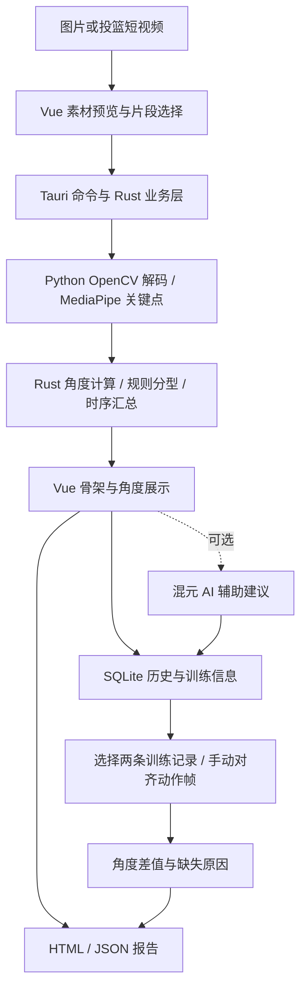

# 毕设实现说明与论文写作提纲

建议题目：《基于 MediaPipe 的篮球投篮姿态分析与训练辅助系统设计与实现》。本文是可继续完善的技术说明与论文提纲，未包含尚未采集的实验数据，不是一篇已完成的毕业论文。

## 研究范围与贡献边界

系统面向个人训练者的离线动作复盘，以单人、固定机位、身体关键部位可见的图片或短视频为主要输入。人体关键点由现成 MediaPipe 模型提供；投篮类型判断和建议基于项目既有规则。混元模型用于可选辅助反馈。

原仓库已有：上传、关键点识别、角度计算、规则分型、时序特征、混元接口、球星模板比较、数据库和历史页面等基础实现。

本次增量：修复图片入口和显示；接通历史保存与防重复；恢复视频历史时保留对比与建议；训练日期/备注/标签与数据库筛选；两次训练逐帧对比；自包含 HTML 与 JSON 导出；实验与环境记录脚本；迁移、状态和浏览器流程测试。个人提交论文时应如实区分原作者代码、辅助开发与本人理解、修改和实验工作。

## 系统结构与数据流

数据库仍主要使用 `analysis_history` 和 `player_templates` 两张表。分析数据、视频抽样帧、建议、对比快照以 JSON 保存；新增训练信息与创建时间分别存储，编辑训练日期不会修改原始分析时间。

| 新增字段 | 类型 | 含义与兼容策略 |
|---|---|---|
| training_date | TEXT | 本地日历日期 YYYY-MM-DD；旧数据由 created_at 转换回填 |
| notes | TEXT | 训练备注，默认空字符串，最多 2000 字 |
| tags_json | TEXT | 标签数组 JSON，默认 []，最多 10 个、每个最多 30 字 |

新增 Tauri 命令：`query_training_history` 在数据库端完成日期区间、精确标签和投篮类型筛选，然后分页；`update_training_metadata` 仅更新训练信息。原保存命令继续返回记录 ID，前端接收 ID 并阻止重复插入。原数据通过增量列迁移保留。

## 算法定义及局限

- 三点关节角：以中间关节为顶点，用两条二维向量的点积和长度计算 arccos，结果单位为度。拍摄角度会影响投影角度。
- “出手角”：现有代码使用肩—腕连线相对水平线的夹角，不是篮球运动轨迹的出射角。
- “躯干倾斜”：现有实现使用肩部中点指向鼻子的方向相对竖直方向的角度，实质偏向头肩姿态指标，不是完整躯干生物力学测量。
- 投篮类型：由固定角度范围、举球高度、动作阶段和时序特征融合判定。输出置信度是规则得分，不等于经过统计校准的准确率。
- 视频：当前最多抽取约 16 帧；并非逐帧实时分析。模板的准备/出手/随挥画像按采样序列位置近似分段，不应描述为精确动作事件检测。
- 参考模板：默认常量模板已标为示例数值。真实模板需记录来源和时间片段。相似度衡量选定姿态特征的接近程度，不等于技术水平。
- 两次训练对比：按训练日期、创建时间排序，人工选择对应动作帧。仅对共同且未被标记低置信度的角度计算“后一次－前一次”；不自动给出训练进步分数。
- AI 建议：不作为真实标签或实验标准答案；断网或未配置时，保留本地分析与报告流程。

## 论文各章材料

| 章节 | 可先完成的内容 | 需要补充的证据 |
|---|---|---|
| 绪论 | 训练复盘场景、目标、系统范围 | 查阅并核实相关研究引用 |
| 相关技术 | Vue、Tauri、SQLite、MediaPipe 的职责 | 使用的官方技术资料与版本 |
| 需求分析 | 用户流程、输入条件、失败提示、功能清单 | 导师任务书最终要求 |
| 系统设计 | 上述结构图、数据流、数据库、界面职责 | 最终实现截图 |
| 系统实现 | 保存防重复、迁移、筛选、帧对比、离线报告 | 关键代码说明和本人贡献记录 |
| 测试与实验 | 自动化测试方法、采样及人工角度评估方法 | 实际训练素材、人工标注、误差表与失败案例 |
| 总结展望 | 完成功能、拍摄条件限制、规则方法局限 | 根据真实实验补充结果结论 |

## 约 7 分钟答辩演示脚本

1. 0:00～0:40：说明训练复盘需求、输入条件与贡献边界。
2. 0:40～2:00：选择短视频，裁剪一次投篮，显示骨架、角度和规则建议。
3. 2:00～3:00：保存历史，编辑训练日期、标签和备注，演示筛选。
4. 3:00～4:30：选择同一训练者的前后两条记录，手动对齐阶段，解释角度变化；不把数值变化直接等同于进步。
5. 4:30～5:15：导出 HTML，在浏览器离线打开，演示打印为 PDF。
6. 5:15～6:15：展示真实样本数、耗时、角度误差与一个失败案例。素材未采集时不可使用本段虚构结果。
7. 6:15～7:00：说明系统局限和后续方向。

可能被问到：为什么无需训练模型？怎么选参考值？二维角度为什么受拍摄影响？为什么人工对齐帧？AI 不可用怎么办？代码和实验哪些是本人完成？请结合上述定义、实际测试和开发记录作答。
